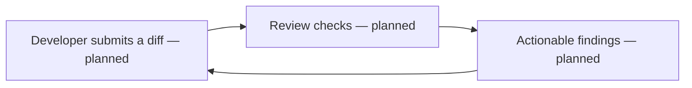

# BugSage — AI Code Review Concept

<strong>A project concept for reviewing source code and returning specific suggestions about quality, structure, and performance.</strong>

## Intended workflow

The diagram shows the proposed product flow, not an implemented system. The repository currently contains its project description and GitHub support files; the application source, provider configuration, run instructions, and demo are not present.

## Before presenting it as runnable

Add the review UI/API, define how source code is handled, keep model keys server-side, and document what the review can and cannot detect. Suggestions should be reviewed by a developer before they are applied.
